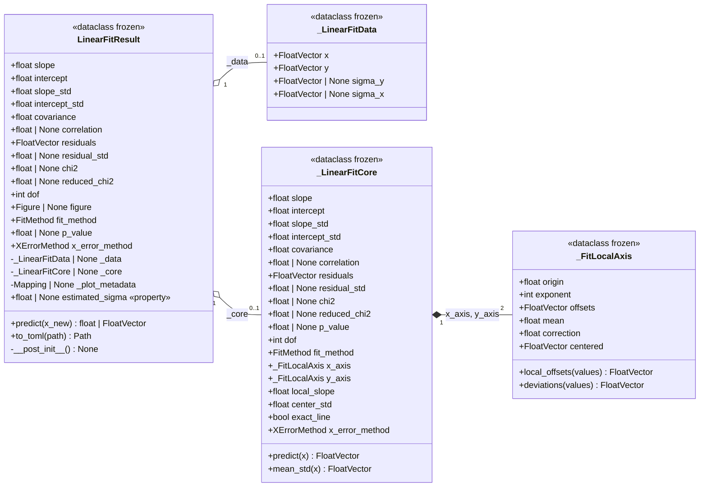

# Classi

MesPy ha quattro classi, tutte in `fit_utils` e tutte dataclass congelate (`frozen=True,
slots=True`). Solo `LinearFitResult` è pubblica; le altre tre sono lo stato interno che il
risultato conserva per poter ricalcolare previsioni ed esportare i dati originali.
`_data` e `_core` sono presenti insieme (risultati di `lin_fit`) oppure entrambi assenti
(risultati costruiti a mano).

Chi le crea: `_validate_linear_fit_data()` → `_LinearFitData`; `_fit_local_axis()` →
`_FitLocalAxis`; `_solve_linear_fit()` → `_LinearFitCore`; `_make_linear_fit_result()` →
`LinearFitResult`. `estimated_sigma` è una property (non un campo).
