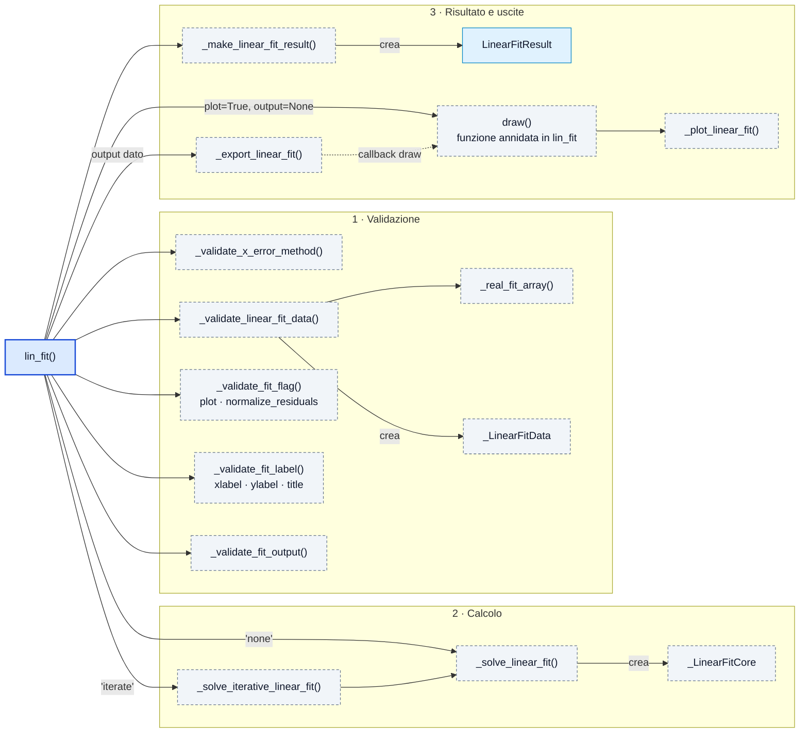
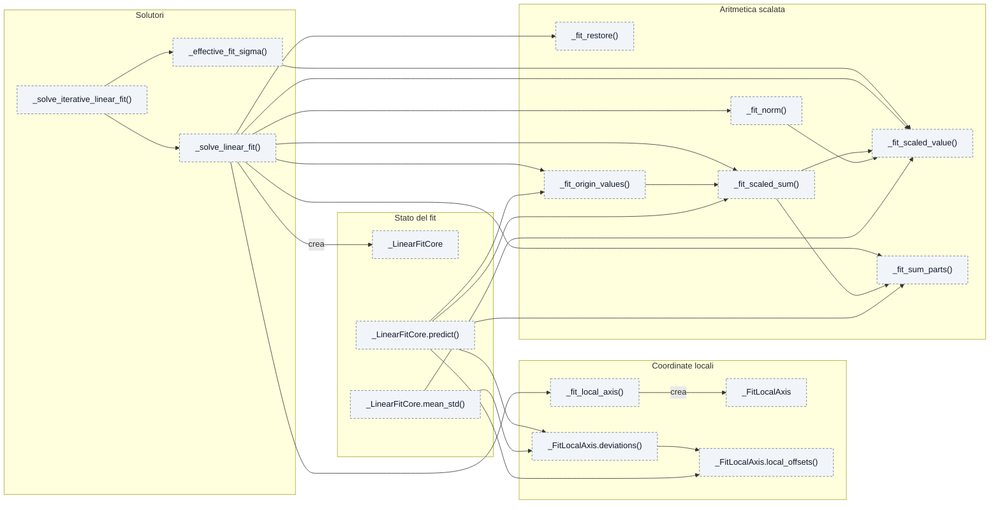
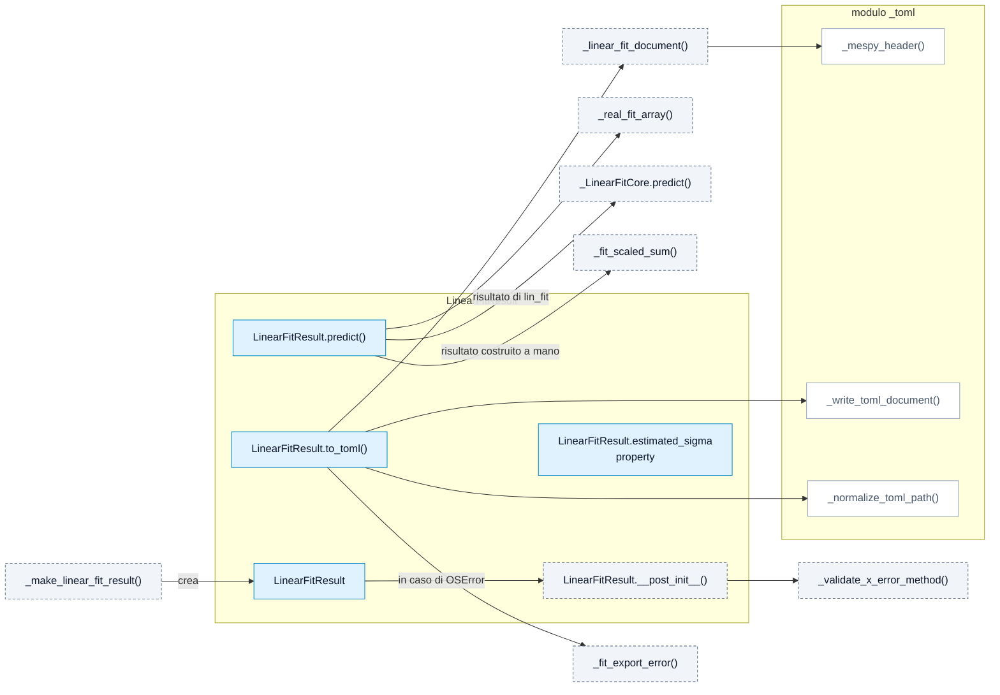
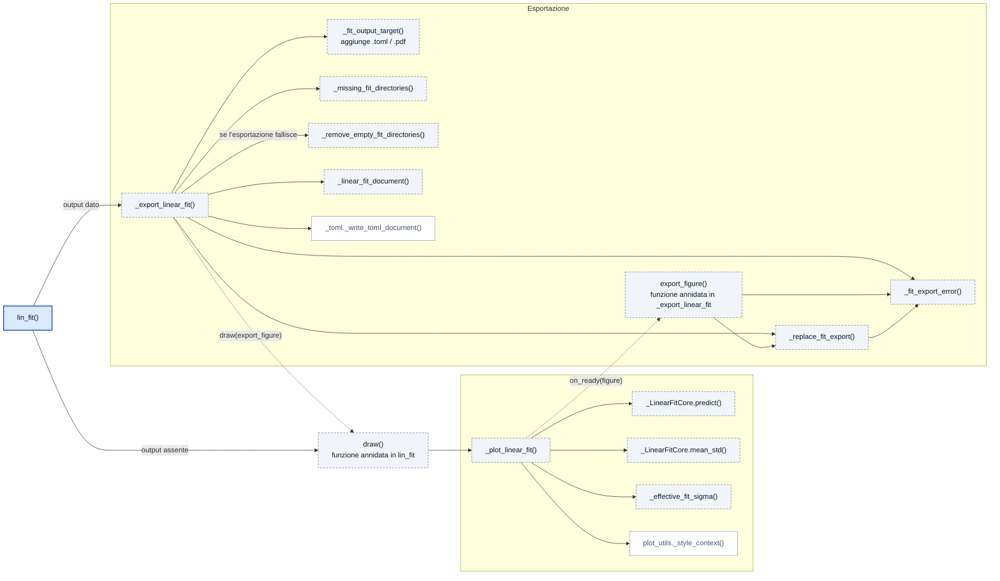

# Modulo `fit_utils`

È il modulo più grande (26 funzioni, 4 classi, 8 metodi): una sola funzione pubblica alla
radice, `lin_fit`, e il tipo `LinearFitResult` pubblico solo come `mespy.fit_utils.LinearFitResult`.
Supera i 25 nodi, quindi è diviso in quattro sottodiagrammi: orchestrazione, nucleo numerico,
oggetto risultato, grafico ed esportazione.

**Legenda comune** — blu pieno: pubblico (`mespy.__all__`); azzurro: pubblico solo nel
sottomodulo; grigio tratteggiato: helper interno; bianco: elemento di un altro modulo;
freccia tratteggiata: chiamata indiretta tramite callback.

## 1. Orchestrazione di `lin_fit`

`lin_fit` non calcola nulla direttamente: valida gli ingressi, sceglie il solutore in base a
`x_error_method` (`'none'` oppure `'iterate'`), costruisce
il risultato e poi, a seconda di `plot` e `output`, disegna e/o esporta. `draw` è una funzione
annidata in `lin_fit` che incapsula la chiamata a `_plot_linear_fit`.

## 2. Nucleo numerico

Il fit è risolto in coordinate locali centrate e scalate per potenze di due, così che
overflow e cancellazioni emergano come `FloatingPointError` invece che come risultati
silenziosamente sbagliati. `_fit_scaled_value` è il mattone su cui poggia quasi tutto;
la modalità iterativa richiama più volte `_solve_linear_fit` con le incertezze efficaci.

## 3. L'oggetto `LinearFitResult`

`_make_linear_fit_result` costruisce il risultato congelato a partire dai dati validati e dallo
stato numerico. I metodi pubblici delegano: `predict` al nucleo conservato (`_core`), `to_toml`
al modulo `_toml`. `__post_init__` rifiuta risultati incoerenti con il fit calcolato.

## 4. Grafico ed esportazione

Con `output` assente `lin_fit` chiama `draw` direttamente. Con `output` dato passa `draw` a
`_export_linear_fit`, che a sua volta le consegna `export_figure`: `_plot_linear_fit` la invoca
come `on_ready` quando la figura è pronta, ancora dentro il contesto di stile. In questo modo
il PDF viene salvato con lo stile scelto e prima della visualizzazione nel notebook.

