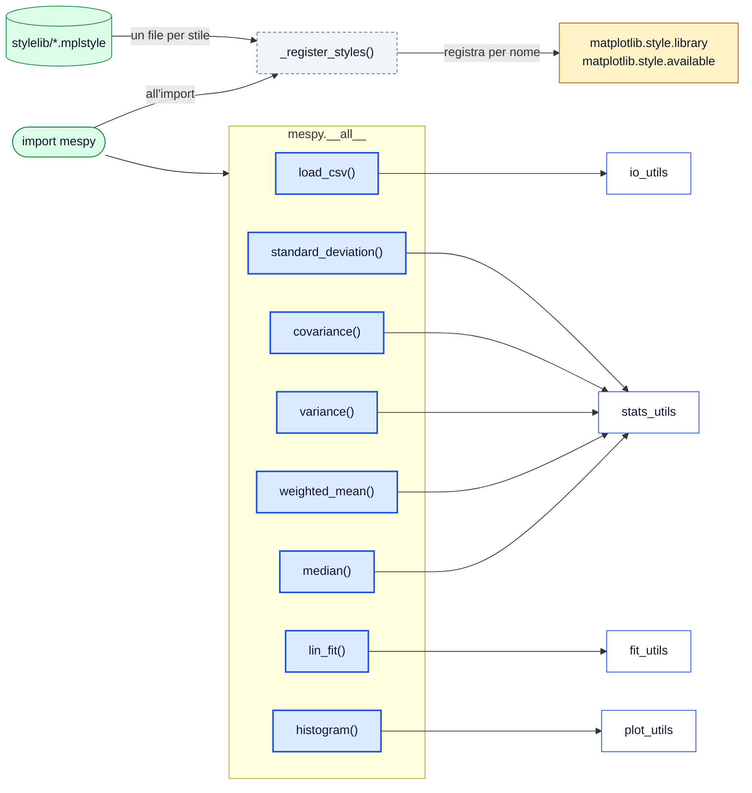

# Modulo `mespy` (`__init__.py`)

La radice del pacchetto fa due cose: riesporta le otto funzioni pubbliche elencate in
`__all__` e, al momento dell'import, esegue `_register_styles()` per rendere disponibili a
Matplotlib gli stili contenuti in `stylelib/`. `LinearFitResult` non è riesportata: resta in
`mespy.fit_utils`.

**Legenda** — blu pieno: nome pubblico; bordo blu: sottomodulo in cui è definito; grigio
tratteggiato: helper interno; giallo: libreria esterna; verde: dati o azione dell'utente.
