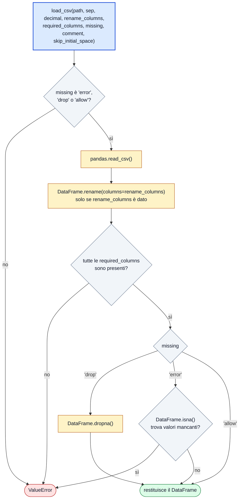

# Modulo `io_utils`

Il modulo contiene una sola funzione, `load_csv`, senza helper interni: è un involucro di
`pandas.read_csv` che trasforma i dati mancanti in una scelta esplicita (`missing`) invece di
lasciare `NaN` silenziosi. Il diagramma mostra quindi i passi interni della funzione, nell'ordine
in cui il codice li esegue.

**Legenda** — blu: funzione pubblica; grigio: controlli scritti dentro `load_csv`; giallo:
chiamate a pandas; verde/rosso: esiti.
