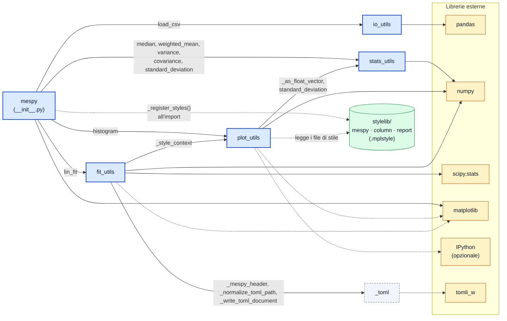

# Architettura a moduli

MesPy è un pacchetto piatto: sei file Python in `src/mespy/` più la cartella `stylelib/`.
Le frecce etichettate sono le dipendenze interne (con i nomi realmente importati); quelle verso
destra sono le librerie esterne. Freccia continua = import in cima al modulo; tratteggiata =
import eseguito solo dentro una funzione (pigro) oppure lettura di file a runtime.

**Legenda** — blu: moduli con API pubblica; grigio tratteggiato: modulo interno; verde: dati
distribuiti col pacchetto; giallo: dipendenze esterne.
