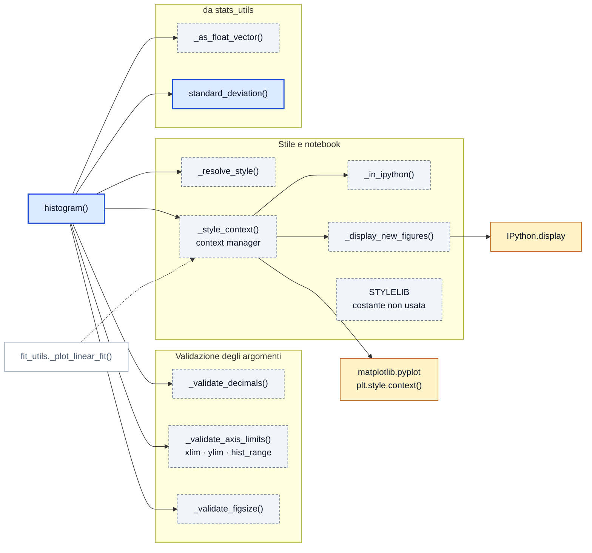

# Modulo `plot_utils`

Una funzione pubblica, `histogram`, e sette helper: tre validano gli argomenti, quattro
gestiscono lo stile Matplotlib temporaneo e la visualizzazione nei notebook. `_style_context` è
l'unico helper usato anche da un altro modulo (`fit_utils`). La costante `STYLELIB` è definita
ma non è referenziata né nel pacchetto né nei test.

**Legenda** — blu: pubblico; grigio tratteggiato: helper interno; giallo: libreria esterna;
bianco: chiamante da un altro modulo. Il percorso completo dello stile è in
[stili.md](stili.md).
