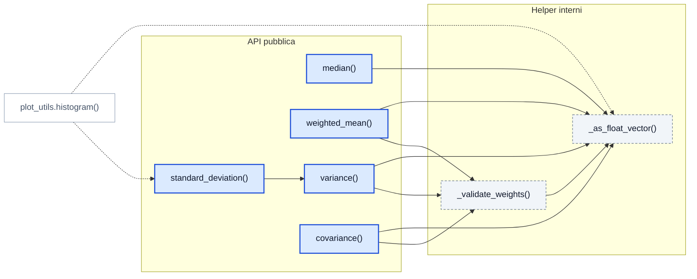

# Modulo `stats_utils`

Cinque funzioni pubbliche di statistica descrittiva (anche pesata) appoggiate a due soli helper
di validazione. `standard_deviation` è la radice di `variance`; tutte le altre convertono e
controllano gli ingressi con `_as_float_vector` e, se ci sono pesi, con `_validate_weights`.

**Legenda** — blu: pubblico (`mespy.__all__`); grigio tratteggiato: helper interno; bianco:
chiamante da un altro modulo (freccia tratteggiata).
