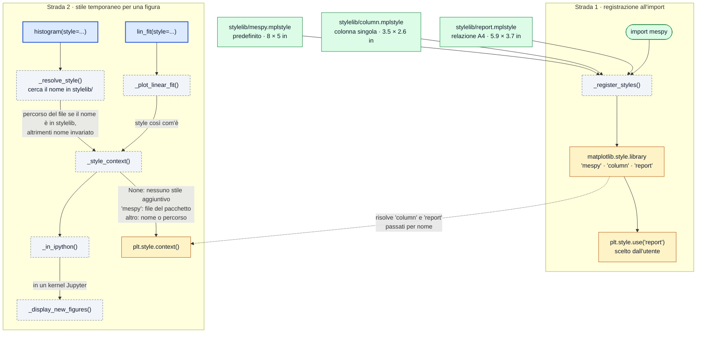

# Sottosistema: i tre stili Matplotlib

`src/mespy/stylelib/` contiene tre fogli di stile distribuiti col pacchetto (package-data
`stylelib/*.mplstyle`): `mespy` (predefinito, schermo
e notebook), `column` (figura a colonna singola) e `report` (relazione A4). Arrivano a Matplotlib
per due strade indipendenti: la registrazione per nome fatta da `import mespy`, e lo stile
temporaneo applicato da `histogram` e `lin_fit` tramite `_style_context`.

**Legenda** — blu: API pubblica; grigio tratteggiato: helper interno; giallo: Matplotlib;
verde: file di stile e azione dell'utente.

Due dettagli che il diagramma rende visibili: `histogram` passa sempre da `_resolve_style`,
quindi anche `"mespy"` arriva a `_style_context` già come percorso; `lin_fit` invece passa il
nome così com'è, e sono il ramo `style == "mespy"` di `_style_context` e la registrazione
all'import a risolvere rispettivamente `"mespy"` e `"column"`/`"report"`.
