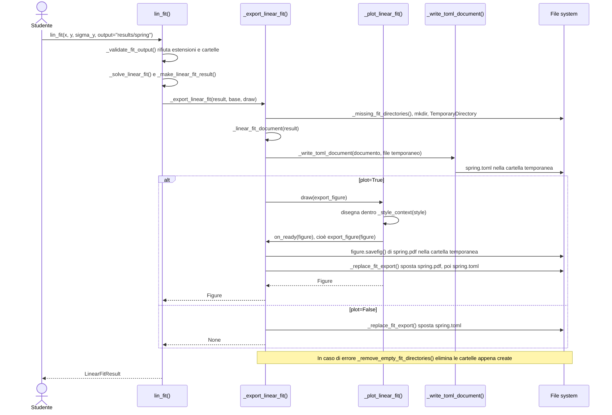
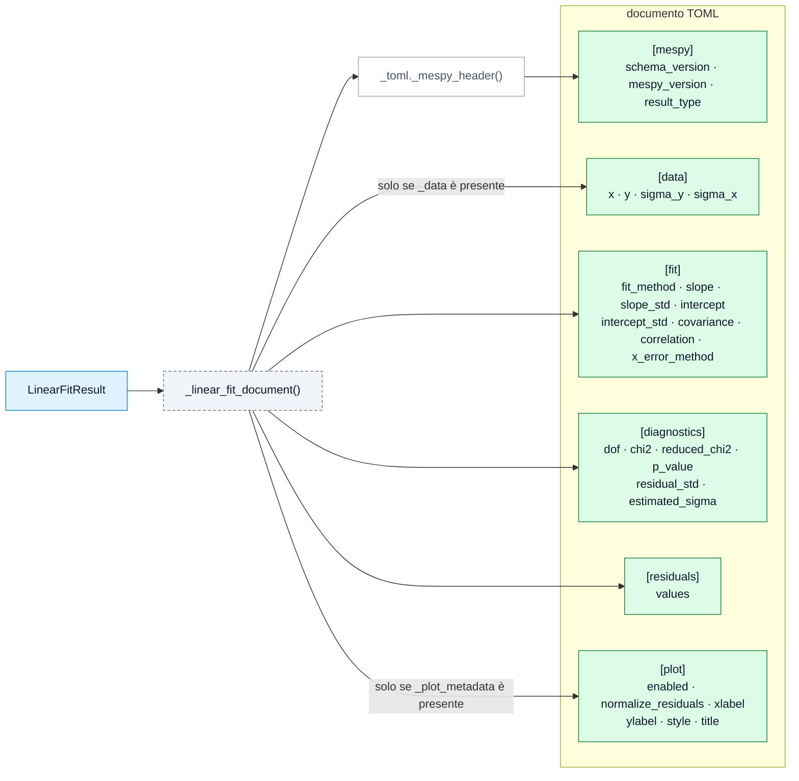

# Sottosistema: esportazione TOML dei fit

Nel codice non esiste una cache: MesPy **scrive** il fit in TOML ma non lo rilegge mai (nessun
lettore in `src/mespy/`), quindi ogni chiamata a `lin_fit` ricalcola tutto. Quello che esiste è
un'esportazione atomica, con due ingressi: `lin_fit(..., output=base)` (crea le cartelle e
scrive `base.toml`, più `base.pdf` se `plot=True`) e `LinearFitResult.to_toml(path)` (solo TOML,
la cartella deve già esistere).

## Sequenza di `lin_fit(..., output="results/spring")`

I file vengono prima preparati in una cartella temporanea accanto alla destinazione e poi
spostati con `os.replace`: un file esistente non resta mai troncato. La coppia PDF + TOML non
è però una transazione unica.

## Struttura del documento

`_linear_fit_document()` costruisce un dizionario con sei tabelle. I campi indefiniti
(`None`) vengono omessi. Lo schema è 2 per i fit con sola `sigma_y`, 3 quando è presente
`sigma_x` o `x_error_method` è diverso da `"none"`.

**Legenda** — azzurro: tipo pubblico del sottomodulo; grigio tratteggiato: helper interno;
bianco: helper di `_toml`; verde: tabelle del file. Le chiamate fra funzioni sono in
[toml.md](toml.md) e [fit_utils.md](fit_utils.md).
