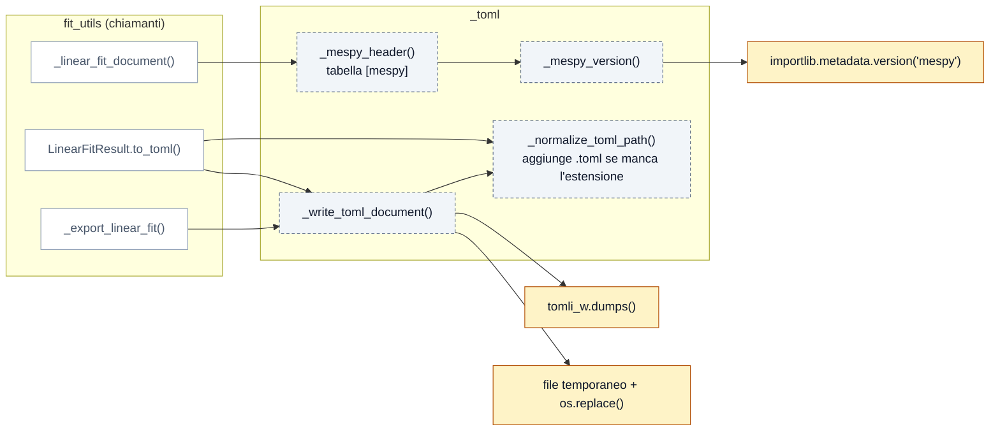

# Modulo `_toml`

Modulo interno (underscore nel nome) con quattro helper per scrivere documenti TOML in modo
atomico. Non contiene alcuna funzione di lettura: MesPy esporta i risultati ma non li ricarica.
Oggi l'unico utilizzatore è `fit_utils`.

**Legenda** — grigio tratteggiato: helper interni di `_toml`; bianco: chiamanti in
`fit_utils`; giallo: libreria standard o esterna. Il flusso completo dell'esportazione è in
[toml-export.md](toml-export.md).
