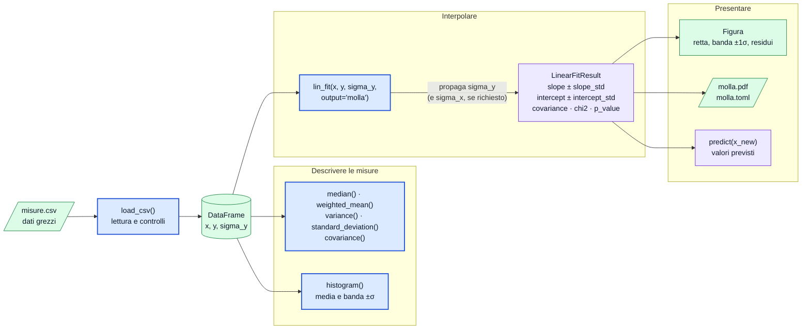

# Il percorso dello studente

Dalla tabella di misure al grafico per la relazione, usando soltanto l'API pubblica
(`import mespy`). La propagazione delle incertezze avviene dentro `lin_fit`: `sigma_y` pesa i
punti e determina le incertezze sui parametri; `sigma_x` entra nel calcolo solo con
`x_error_method="iterate"`. I nomi dei file (`misure.csv`, `molla`) sono esempi.

**Legenda** — blu: funzioni di `mespy`; viola: l'oggetto restituito da `lin_fit` e i suoi
metodi; verde: dati e file. Lo stile grafico si sceglie con `style=` (`"mespy"`, `"column"`,
`"report"`): vedi [stili.md](stili.md).

> MesPy non ha una funzione generale di propagazione degli errori per grandezze derivate
> (per esempio `g` ricavata dalla pendenza): quel passaggio lo studente lo svolge a mano
> partendo da `slope_std`, `intercept_std` e `covariance`.
